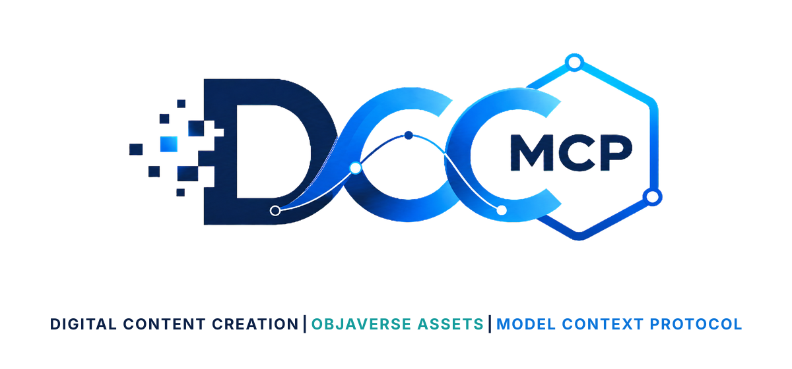
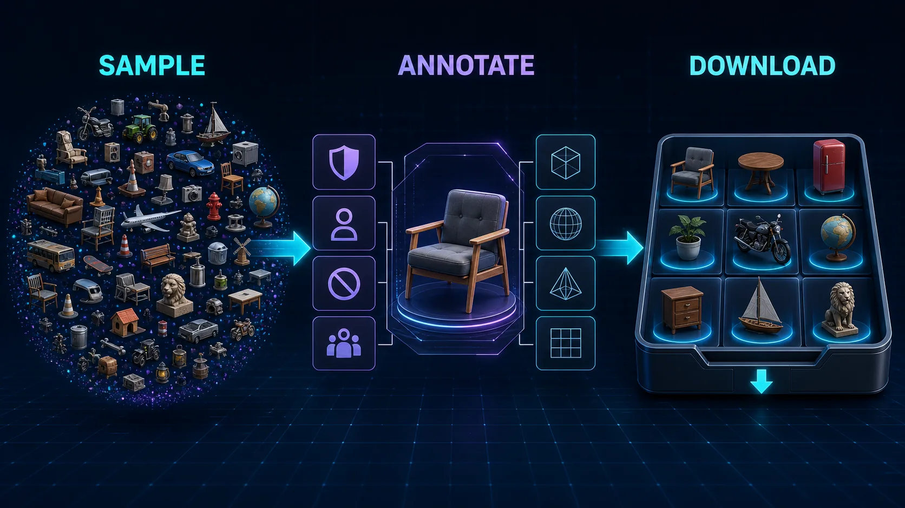

# DCC-MCP Objaverse Assets

<p align="center">
  
</p>

## Agent workflow

AI agents should use installed package skills through the shared gateway. IDE
users may continue to use the MCP endpoint.

```bash
dcc-mcp-cli dcc-types
dcc-mcp-cli list
dcc-mcp-cli search --query "<task>" --dcc-type <host>
dcc-mcp-cli describe <tool-slug>
dcc-mcp-cli call <tool-slug> --json '{"key":"value"}'
```

If the package skill is not active, call
`dcc-mcp-cli load-skill <skill-name> --dcc-type <host>`. After the task,
query `dcc-mcp-cli stats --range 24h --session-id <task-id>` and pass only
bounded evidence to the `review_skill_improvement` prompt from
`dcc-mcp-skills-creator`.




Objaverse discovery and GLB download tools for DCC-MCP.

This skill is a thin wrapper around the official `objaverse` Python package.
It does not import files into a DCC scene; host import belongs in host skills.

## Install

```bash
dcc-mcp-cli marketplace add dcc-mcp/dcc-asset-objaverse
dcc-mcp-cli marketplace install dcc-asset-objaverse
```

## Requirements

```bash
python -m pip install objaverse
```

## Tools

- `sample_objaverse_uids`
- `get_objaverse_annotations`
- `download_objaverse_objects`

## License Notes

This wrapper is MIT licensed. Objaverse as a dataset is licensed separately;
individual objects carry their own Creative Commons licenses. Always keep the
returned `license` and attribution metadata with downloaded assets.
