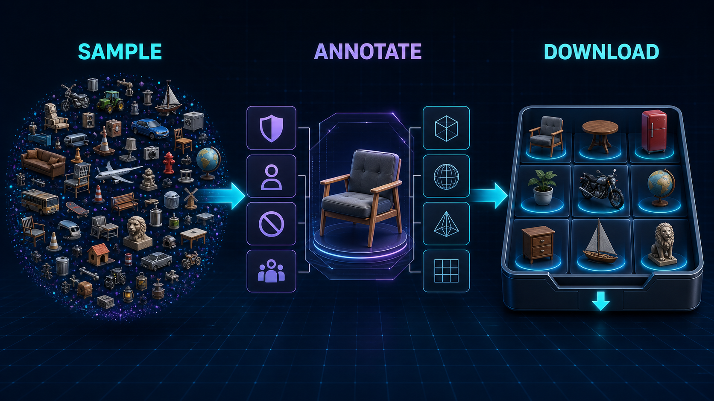

# DCC-MCP Objaverse Assets



Objaverse discovery and GLB download tools for DCC-MCP.

This skill is a thin wrapper around the official `objaverse` Python package.
It does not import files into a DCC scene; host import belongs in host skills.

## Install

```bash
dcc-mcp-cli marketplace add dcc-mcp/dcc-asset-objaverse
dcc-mcp-cli marketplace install dcc-asset-objaverse
```

## Requirements

```bash
python -m pip install objaverse
```

## Tools

- `sample_objaverse_uids`
- `get_objaverse_annotations`
- `download_objaverse_objects`

## License Notes

This wrapper is MIT licensed. Objaverse as a dataset is licensed separately;
individual objects carry their own Creative Commons licenses. Always keep the
returned `license` and attribution metadata with downloaded assets.
